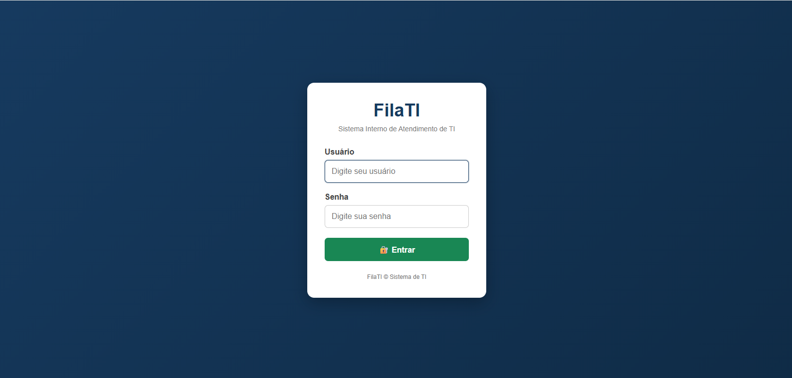
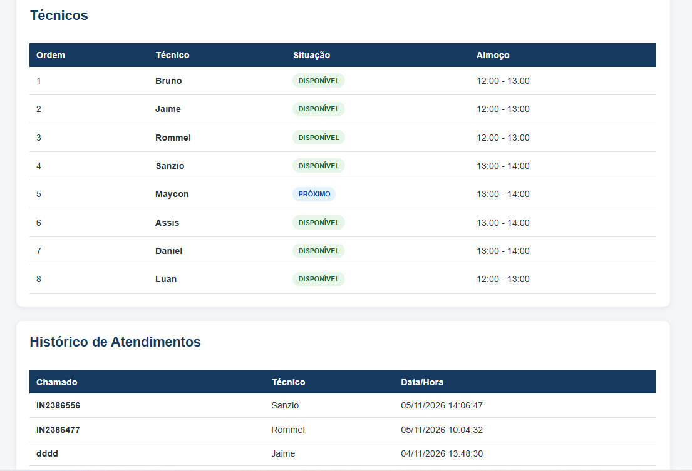

# FilaTIWeb – Sistema de Gerenciamento de Fila de TI

## Sobre o projeto

Sistema web desenvolvido em Java para gerenciamento de atendimentos e solicitações de suporte técnico de TI.

## Funcionalidades

- Login e autenticação de usuários.
- Controle de acesso.
- Cadastro de técnicos.
- Edição de técnicos.
- Gerenciamento da fila de atendimentos.
- Geração de relatórios.
- Exportação de relatórios para Excel.

## Tecnologias utilizadas

- Java
- Jakarta EE 11
- JSP
- Servlets
- HTML
- Maven
- Banco de dados relacional

## Como executar

1. Clonar o repositório.
2. Abrir o projeto no Apache NetBeans.
3. Configurar o banco de dados.
4. Configurar o servidor de aplicação.
5. Executar o projeto.

## Telas do sistema

### Tela de Login

### Tela de Inserção de Chamados

### Tela de Histórico de Técnicos

## Autor

**Assis da Costa Pinto Júnior**

GitHub: https://github.com/assicsjunior

